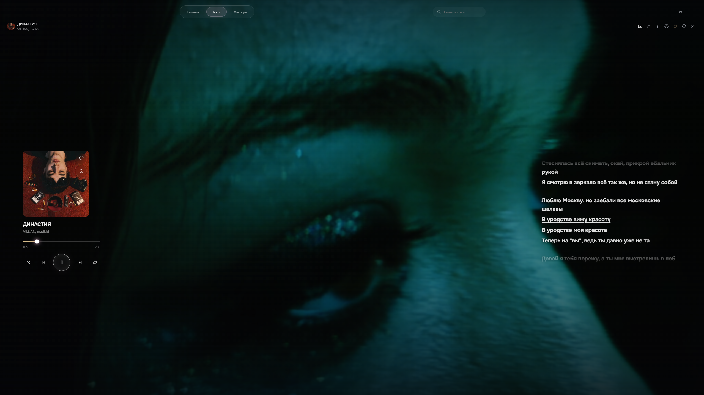

<p align="center">
  
</p>

<h1 align="center">Aureon</h1>

<p align="center">
  Неофициальный клиент Яндекс Музыки для Windows и Linux.<br>
  Для каталога нужен аккаунт с Яндекс Плюсом.
</p>

<p align="center">
  <strong><a href="https://github.com/simfonyy/aureon/releases/latest">Скачать Aureon ↓</a></strong>
</p>



[Превью Aureon v2](docs/screenshots/v2/README.md) — шесть кадров из следующего обновления.

## Что внутри

- **Клип на весь экран.** Включается с обложки и может идти за текстом песни. Уведи курсор, и обложка уйдёт в угол. Размытие можно убрать, а синхронизацию Aureon запоминает для каждого трека.
- **Караоке.** Подсветка по словам или по строкам. Если текст спешит или отстаёт, подвинь тайминг для этой песни. В режиме «Авто» Aureon ищет версию с таймкодами в нескольких каталогах.
- **Мини-плеер.** Прикрепи его к краю рабочего стола. Клик по обложке ставит трек на паузу, колесо меняет громкость.
- **Поиск и очередь.** Вбей пару слов из песни в поиске по строчке. В быстром поиске (`Ctrl+K`) можно поставить выбранный трек следующим через `Shift+Enter`.
- **Моя волна.** Сочетай настроение, язык и разнообразие. На главной — свежие релизы и альбомы, которые ты недавно слушал.
- **Своя музыка.** Добавляй локальные файлы в библиотеку и сохраняй очередь как приватный плейлист.
- **Discord.** Показывай трек или исполнителя в статусе. Друзья могут открыть песню прямо оттуда.

[Больше скриншотов](docs/screenshots/INDEX.md)

## Установка

Открой **Assets** в последнем релизе и выбери файл под свою систему.

| Система | Файл | Как запустить |
| --- | --- | --- |
| **Windows x64** | `_x64_ru-RU.msi` | Открой установщик. После установки Aureon появится в меню «Пуск». |
| **Windows x64 · portable** | `_windows-x64_portable.zip` | Выбери «Извлечь всё», затем запусти `Aureon.exe` из распакованной папки. |
| **Ubuntu / Debian x64** | `_amd64.deb` | Открой пакет установщиком или выполни `sudo apt install ./имя-файла.deb`. |
| **Linux x64 · AppImage** | `_amd64.AppImage` | Разреши запуск в свойствах файла и открой его. |

В Windows автообновление работает с версии 1.2.2. Если у тебя более ранняя версия, обновись один раз вручную.

В следующих обновлениях планирую выпустить сборку для Android и `.ipa` для iPhone. Не теряйте :)

## Собрать самому

<details>
<summary>Windows · MSI</summary>

Понадобятся Git, Node.js 22 с npm, Rust через rustup (x64 MSVC) и Visual Studio Build Tools с набором «Разработка классических приложений на C++» и Windows SDK. Для запуска нужен Microsoft Edge WebView2 Runtime.

```powershell
git clone https://github.com/simfonyy/aureon.git
cd aureon/app
.\scripts\build\Build-MSI.bat
```

Скрипт установит зависимости и откроет папку с MSI после сборки. Результат лежит в `app/src-tauri/target/release/bundle/msi/`, журнал сборки — в `app/build-logs/`.

Для разработки из `aureon/app` запусти `npm.cmd run tauri:dev` после установки зависимостей через `npm.cmd ci`.

</details>

<details>
<summary>Linux · DEB и AppImage</summary>

Команды рассчитаны на Ubuntu 22.04 x64. Понадобятся Node.js 22 с npm, Rust stable через rustup и системные пакеты.

```bash
sudo apt update
sudo apt install git build-essential curl wget file pkg-config patchelf xdg-utils \
  libwebkit2gtk-4.1-dev libayatana-appindicator3-dev librsvg2-dev libssl-dev \
  libsecret-1-dev libdbus-1-dev libfuse2 gstreamer1.0-plugins-base \
  gstreamer1.0-plugins-good gstreamer1.0-plugins-bad gstreamer1.0-libav

git clone https://github.com/simfonyy/aureon.git
cd aureon/app
npm ci
bash scripts/build/Build-Linux.sh
```

Пакеты появятся в `app/src-tauri/target/release/bundle/deb/` и `app/src-tauri/target/release/bundle/appimage/`. Для разработки запусти `npm run tauri:dev` из `aureon/app`.

</details>

## Авторы

Aureon вырос из [Mashiro](https://github.com/aeviww/yandex-music-client). Код распространяется по [GPL-3.0-or-later](LICENSE).

<details>
<summary>Источники и лицензии</summary>

Тексты ищутся в Яндекс Музыке, [LRCLIB](https://lrclib.net), [Genius](https://genius.com), NetEase, KuGou и QQ Music. Если доступны только тайминги строк, подсветка слов приблизительная.

Для работы с каталогом использованы [MarshalX/yandex-music-api](https://github.com/MarshalX/yandex-music-api) и [vyfor/yandex-music-rs](https://github.com/vyfor/yandex-music-rs). Фильтр AI-треков использует [Slopless](https://github.com/alexeyfv/slopless). Источники версий без цензуры — [FckCensor](https://github.com/Hazzz895/FckCensor) и [FckCensorData](https://github.com/Hazzz895/FckCensorData).

Уведомления об авторских правах собраны в [NOTICE](docs/NOTICE). Лицензия шаблона установщика лежит в [app/src-tauri/installer](app/src-tauri/installer).

</details>
