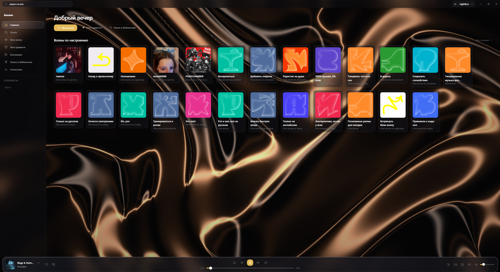
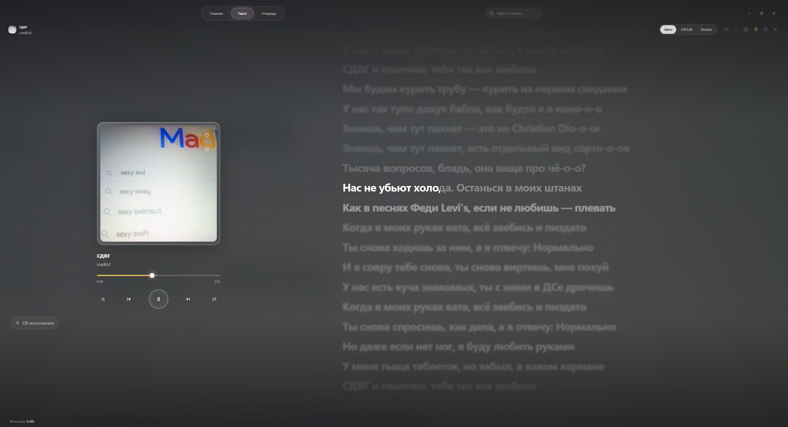
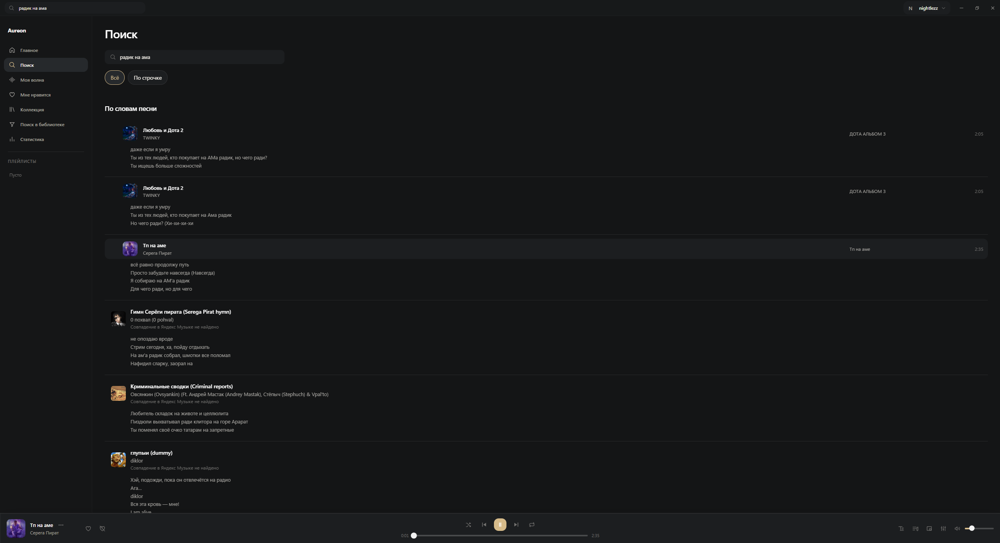

<p align="center">
  
</p>
<h1 align="center">Aureon</h1>
<p align="center">Яндекс Музыка на компьютере. Караоке, поиск по строчке и своё оформление.</p>
<p align="center">
  <a href="https://github.com/simfonyy/aureon/releases/latest">Скачать</a> ·
  <a href="CHANGELOG.md">Что нового</a> ·
  <a href="docs/screenshots/INDEX.md">Скриншоты</a> ·
  <a href="https://github.com/simfonyy/aureon/issues/new/choose">Сообщить о баге</a>
</p>



Aureon — неофициальный клиент Яндекс Музыки для Windows и Linux. Вход через аккаунт Яндекса; доступ к музыке зависит от твоего аккаунта (Наличие Плюса). 

## В обновлении 1.0.1

- **Караоке по словам.** Текст подхватывается автоматически, слова подсвечиваются во время воспроизведения. Перед первой строкой — отсчёт.
- **Поиск по строчке.** Введи слова, которые помнишь. Совпадения из Genius сопоставляются с треками в Яндекс Музыке.
- **Поиск с опечатками.** `серега приат`, `serega pirat` или `cthtuf gbhfn` — поиск проверяет близкое написание, транслит и раскладку.
- **Матовая тема.** Спокойные поверхности без анимированного фона. Живые фоны и настройка цветов тоже доступны.
- **Фильтр AI-треков.** Можно пропускать треки, отмеченные в базе Slopless.

Очередь, переходы между строками и сохранение оформления также исправлены. [Полный журнал изменений →](CHANGELOG.md)

| Караоке | Поиск по словам песни |
| --- | --- |
| [](docs/screenshots/lyrics.png) | [](docs/screenshots/search.png) |

[Все скриншоты: плеер, исполнитель, статистика и оформление →](docs/screenshots/INDEX.md)

Если источник содержит время только для строк, подсветка слов рассчитывается приблизительно. Текст без таймингов показывается без караоке. Поиск по строчке не добавляет в каталог Яндекса отсутствующие песни, а фильтр AI-треков зависит от покрытия Slopless.

## Установка

Готовые выпуски находятся в **[Releases](https://github.com/simfonyy/aureon/releases/latest)**. До публикации 1.0.1 новые функции доступны в [тестовых сборках Actions](https://github.com/simfonyy/aureon/actions/workflows/desktop-packages.yml): открой успешный запуск и скачай архив в разделе Artifacts.

| Система | Формат | Как запустить |
| --- | --- | --- |
| Windows x64 | MSI | Открыть установщик |
| Windows x64 | ZIP без установки | Распаковать и запустить `Aureon.exe` |
| Linux x64 | DEB | Установить через менеджер пакетов |
| Linux x64 | AppImage | Разрешить выполнение и открыть файл |

Для Windows нужен WebView2 Runtime; MSI установит его при необходимости. Версии без установки хранят настройки в профиле пользователя. Linux пока экспериментальный: установка и воспроизведение на реальном компьютере требуют проверки. [Подробности и требования к системе →](docs/DISTRIBUTION.md)

## Ещё в приложении

«Моя волна», плейлисты и любимые треки, очередь, мини-плеер, эквалайзер, горячие клавиши и работа в трее. Есть статистика прослушивания, статус текущего трека в Discord и замена цензурированных версий по базе FckCensorData.

## Разработка

Vue 3 и Quasar для интерфейса, Rust и Tauri 2 для нативной части.

Нужны Node.js 22, npm, Rust stable и системные зависимости Tauri. На Windows — Visual Studio Build Tools с C++ и Windows SDK. [Зависимости Linux и сборка пакетов](docs/DISTRIBUTION.md).

```sh
npm ci
npm run tauri:dev
```

`npm run dev` запускает только интерфейс. Для нативных функций нужен запуск через Tauri.

```sh
npm test
npm run build
cargo test --locked --lib --manifest-path src-tauri/Cargo.toml
```

Windows: `Build-MSI.bat`. Linux: `bash Build-Linux.sh`. Сборки обеих систем: [Desktop packages](.github/workflows/desktop-packages.yml).

Для бага укажи версию, систему и шаги воспроизведения в [Issue](https://github.com/simfonyy/aureon/issues/new/choose). [Как внести изменения →](CONTRIBUTING.md)

## Основа и источники

Aureon основан на [Mashiro — aeviww/yandex-music-client](https://github.com/aeviww/yandex-music-client).

- [MarshalX/yandex-music-api](https://github.com/MarshalX/yandex-music-api) и [vyfor/yandex-music-rs](https://github.com/vyfor/yandex-music-rs) — описание и схемы API Яндекс Музыки.
- [FckCensor](https://github.com/Hazzz895/FckCensor) и [FckCensorData](https://github.com/Hazzz895/FckCensorData) — версии треков без цензуры.
- [Slopless](https://github.com/alexeyfv/slopless) — данные об AI-музыке.
- [LRCLIB](https://lrclib.net) и [Genius](https://genius.com) — тексты песен.

**GPL-3.0-or-later** · [LICENSE](LICENSE) · [NOTICE](NOTICE). Лицензия шаблона установщика — в [src-tauri/installer](src-tauri/installer).

Яндекс не участвует в разработке Aureon.
