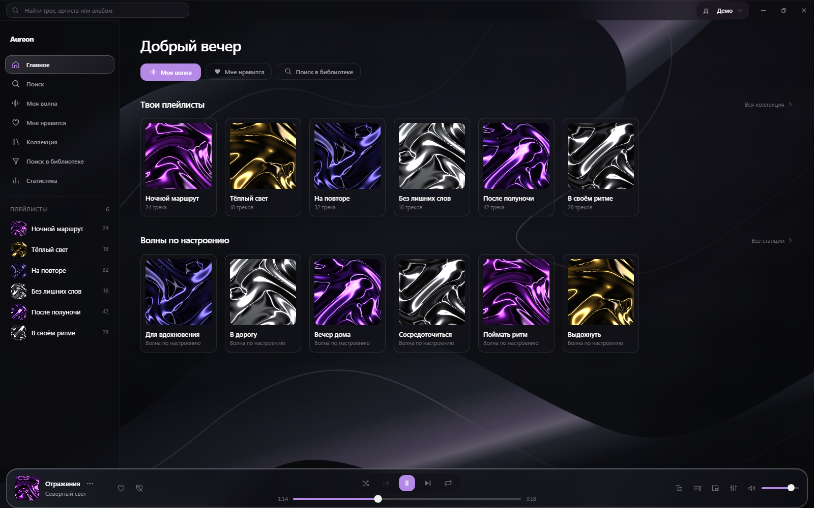

<p align="center">
  
</p>

<h1 align="center">Aureon</h1>
<p align="center">Неофициальный клиент Яндекс Музыки для компьютера.</p>
<p align="center">
  <a href="https://github.com/simfonyy/aureon/releases/latest">Скачать</a> ·
  <a href="CHANGELOG.md">Что нового</a> ·
  <a href="docs/screenshots/INDEX.md">Скриншоты</a> ·
  <a href="https://github.com/simfonyy/aureon/issues/new/choose">Сообщить о баге</a>
</p>



## Установка

**[Последний опубликованный релиз — v1.0.0](https://github.com/simfonyy/aureon/releases/tag/v1.0.0).** Скачай `.msi`, открой установщик и войди в аккаунт Яндекса. Для прослушивания нужен доступ к музыке в твоём аккаунте.

Новые изменения перечислены в [журнале обновлений](CHANGELOG.md). Они появятся в установщике после следующего релиза. Скриншот выше показывает интерфейс v1.0.0 с демонстрационными данными.

| Система | Формат | Статус |
| --- | --- | --- |
| Windows x64 | `.msi` | Доступен в Releases |
| Windows x64 | ZIP без установки | Подготовлен для сборки в Actions |
| Linux x64 | `.deb`, `.AppImage` | Экспериментальные сборки; требуется проверка на Linux |

Вариант без установки хранит настройки в профиле системы, а не рядом с приложением. [Сборки и требования к системе →](docs/DISTRIBUTION.md)

## Что умеет

- «Моя волна», плейлисты, любимые треки и поиск по каталогу.
- Текст песни, очередь воспроизведения и переход к нужному месту по нажатию на строку с таймингом.
- Мини-плеер, эквалайзер, горячие клавиши и работа в трее.
- Живые и статичные фоны, настройки цветов и расположения элементов плеера.
- Текущий трек в Discord.
- Замена цензурированной версии, если подходящий трек есть в базе FckCensorData.

### В следующем обновлении

**Караоке по словам.** Подсветка движется вместе с воспроизведением. Если источник содержит только время строк, время отдельных слов рассчитывается приблизительно. Тексты без таймингов показываются обычным списком.

**Поиск по строчке.** Введи несколько слов из песни или выбери «По строчке». Aureon ищет совпадения в Genius и сопоставляет их с каталогом Яндекса. Трек можно включить, если найдено соответствие по названию и исполнителю.

**Опечатки и раскладка.** Поиск проверяет варианты написания: `серега приат`, `serega pirat`, `cthtuf gbhfn`. Близкие запросы выводятся рядом с результатами. Это транслит и исправление раскладки, не перевод названий.

Также добавлены матовая тема, системные медиаконтроли и настройка пропуска AI-треков по данным Slopless. Покрытие текстов и точность определения AI-треков зависят от внешних источников.

## Разработка

Интерфейс — Vue 3 и Quasar. Нативная часть — Rust и Tauri 2.

Нужны Node.js 22, npm, Rust stable и системные зависимости Tauri. На Windows — Visual Studio Build Tools с C++ и Windows SDK. [Инструкция для Linux и сборка установщиков](docs/DISTRIBUTION.md).

```sh
npm ci
npm run tauri:dev
```

`npm run dev` запускает только интерфейс; для нативных функций нужен запуск через Tauri.

```sh
npm test
npm run build
cargo test --locked --lib --manifest-path src-tauri/Cargo.toml
```

Windows-установщик собирается через `Build-MSI.bat`, Linux-пакеты — через `bash Build-Linux.sh`. В GitHub Actions подготовлен workflow [Desktop packages](.github/workflows/desktop-packages.yml).

## Обратная связь

[Сообщи о баге или предложи изменение](https://github.com/simfonyy/aureon/issues/new/choose). Для ошибки нужны версия приложения, система и шаги воспроизведения. Не прикладывай токены, cookies и данные входа. [Как внести изменения в код](CONTRIBUTING.md).

## Основа и источники

Aureon создан на основе [Mashiro — aeviww/yandex-music-client](https://github.com/aeviww/yandex-music-client).

- [MarshallX/yandex-music-api](https://github.com/MarshallX/yandex-music-api) — описание неофициального API Яндекс Музыки.
- [vyfor/yandex-music-rs](https://github.com/vyfor/yandex-music-rs) — схемы ответов для Rust.
- [FckCensor](https://github.com/Hazzz895/FckCensor) и [FckCensorData](https://github.com/Hazzz895/FckCensorData) — работа с цензурированными версиями.
- [Slopless](https://github.com/alexeyfv/slopless) — данные для фильтра AI-треков.
- [LRCLIB](https://github.com/tranxuanthang/lrclib) и [Genius](https://genius.com) — тексты песен.

Лицензия **GPL-3.0-or-later**: [LICENSE](LICENSE), [NOTICE](NOTICE). Отдельные источники и лицензия шаблона установщика — в [src-tauri/installer](src-tauri/installer).

Aureon не связан с Яндексом и не является его официальным приложением.
