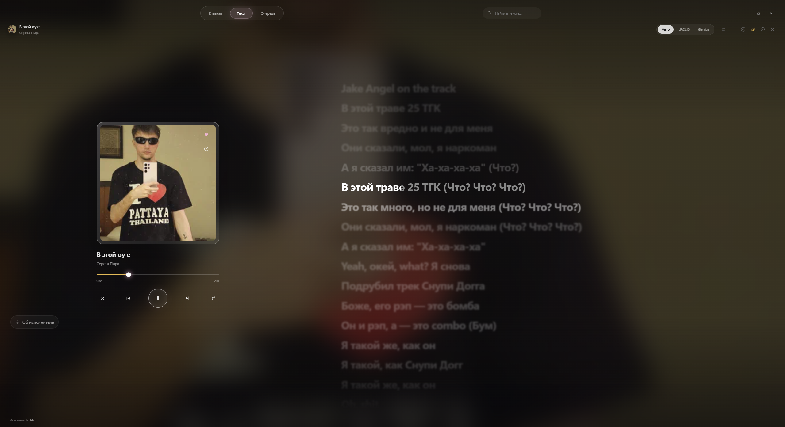
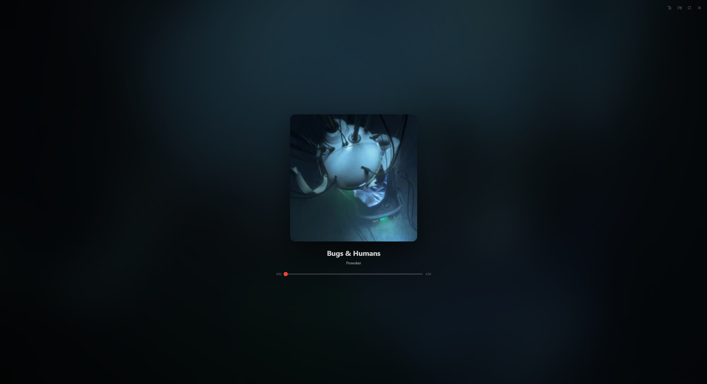
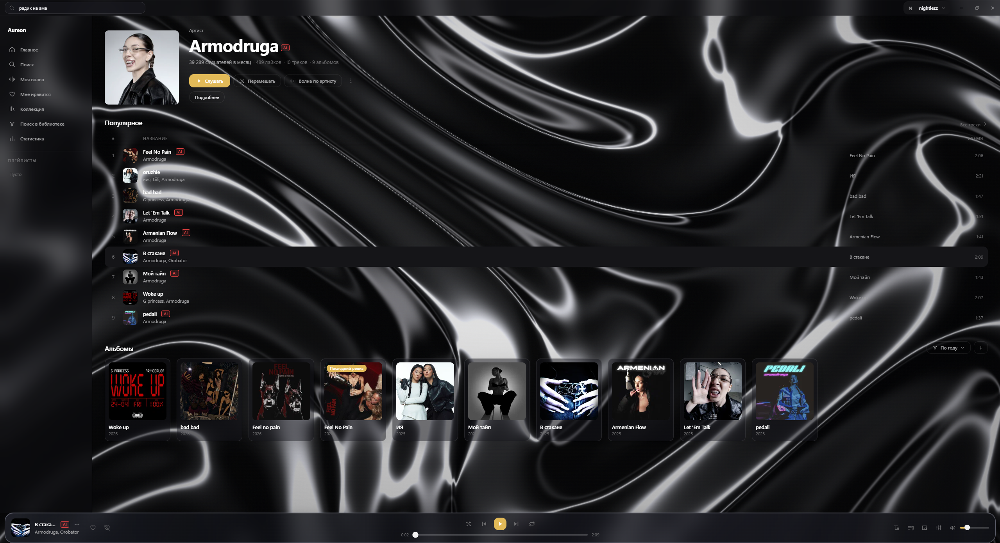
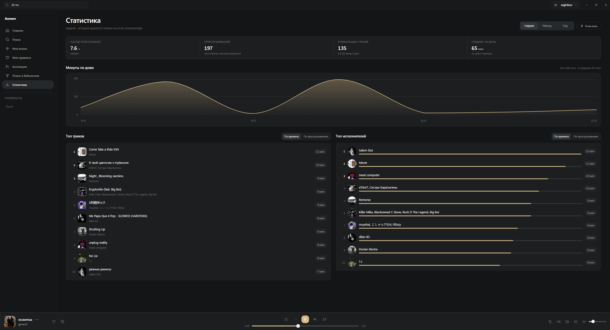

# Aureon в работе

[← К описанию проекта](../../README.md)

Скриншоты текущего интерфейса: поиск, караоке, плеер и оформление.

## Главная и «Моя волна»

## Поиск по строчке

## Караоке по словам

## Плеер

## Исполнитель

## Статистика

