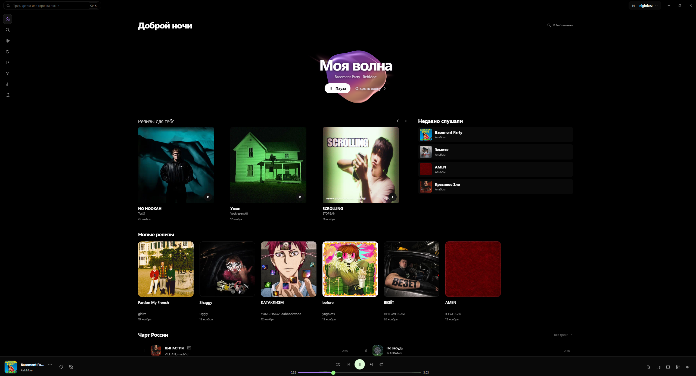
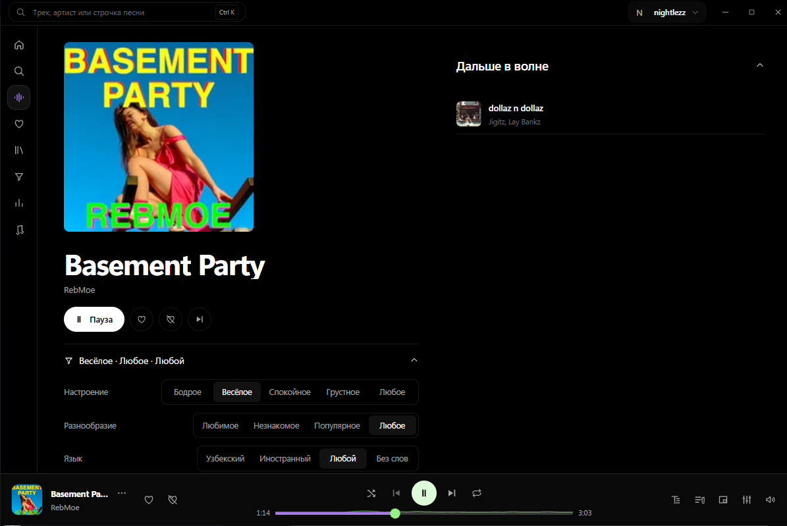
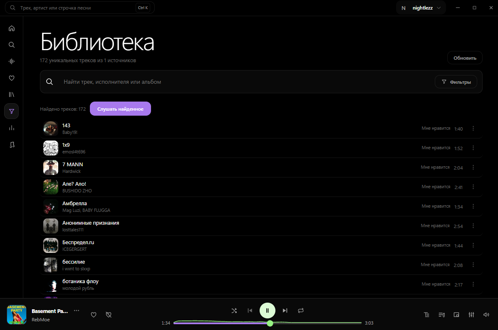
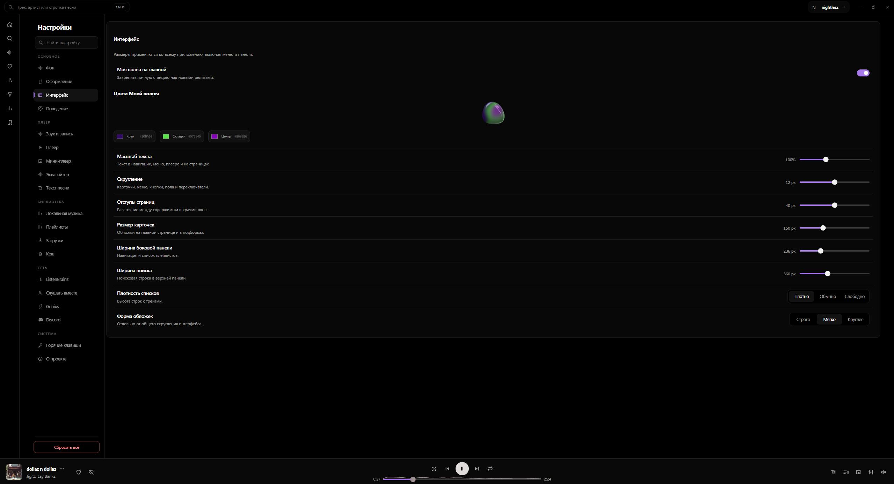
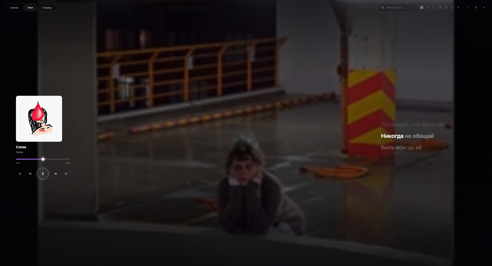
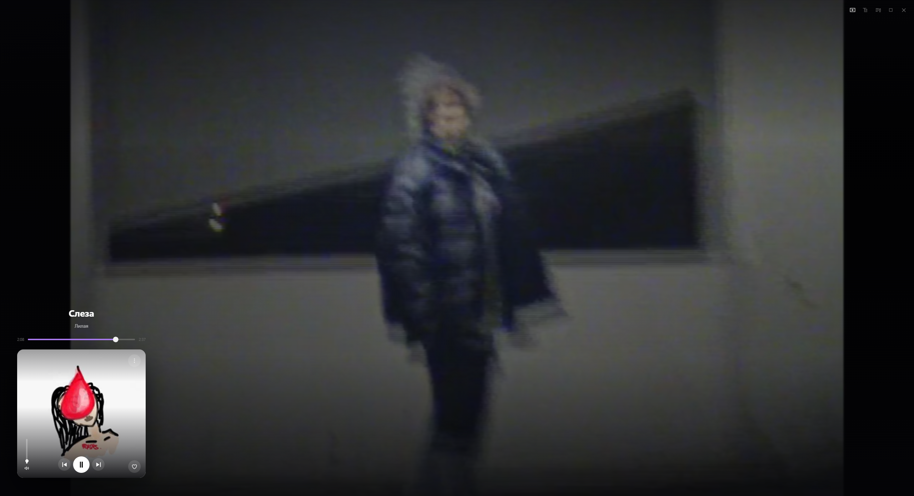

# Aureon v2 Preview

Первые кадры из разработки. На главной появилась «Моя волна» со сферой, которая реагирует на музыку. Ниже — сама Волна, библиотека и плеер.

## Главная

## Моя волна

## Библиотека

## Настройки интерфейса

## Текст поверх клипа

## Полноэкранный плеер

